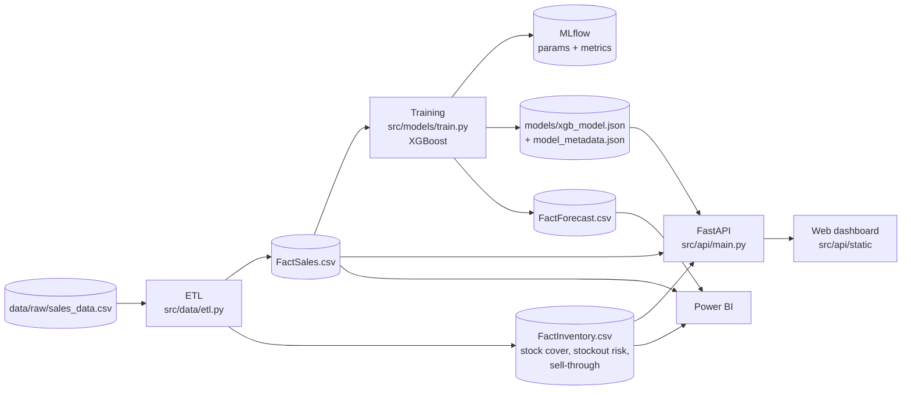

# Retail Sales Forecasting & Inventory Health

An end-to-end analytics pipeline for retail demand forecasting and inventory-health monitoring at
**Store × SKU** level: ETL → inventory KPIs → XGBoost demand model tracked with MLflow → FastAPI
service with a small web dashboard → Power BI-ready fact tables.

Final Year Project (COSC-4301), BSc Computer Science (AI), The Islamia University of Bahawalpur, session 2022–2026.

| | |
|---|---|
| **Author** | Ali Moiez |
| **Supervisor** | Dr. Omer Ajmal |
| **Institution** | The Islamia University of Bahawalpur (IUB), Department of Computer Science |


*The running dashboard (`src/api/static`) for Store S001, SKU P0001, served by the FastAPI app from the generated fact tables and the trained model.*

> **Status:** working prototype. The ETL, inventory KPIs, model training, experiment tracking, per-SKU forecast
> API and dashboard run end to end. Several items from the original SRS are only partially implemented. See
> [Scope and known limitations](#scope-and-known-limitations) before relying on any number produced here.

## What it does

| Stage | What happens | Code |
|---|---|---|
| Ingest & clean | Reads the raw daily Store × SKU CSV, parses dates, fills missing values | `src/data/etl.py` |
| Inventory KPIs | Computes **Stock Cover (days)**, **Stockout Risk** flag and **Sell-Through Rate** | `src/data/etl.py` |
| Model training | Trains an XGBoost regressor on price, discount, promotion, calendar and categorical features; logs params and metrics to MLflow | `src/models/train.py` |
| Forecast table | Writes model predictions to `FactForecast.csv` for BI use | `src/models/train.py` |
| Forecast service | Per-Store × SKU forecasts with empirical 80% intervals; baseline fallback if no model is available | `src/models/predict.py` |
| Serving | FastAPI endpoints for sales history, inventory KPIs and forecasts, plus a dashboard at `/` | `src/api/` |
| BI | `FactSales`, `FactInventory`, `FactForecast` CSVs are designed to load into Power BI | [docs/deployment.md](docs/deployment.md) |

## Screenshots

**Web dashboard** (real captures of the running application):

| Store S001, SKU P0001 | Store S004, SKU P0001 |
|---|---|
|  |  |

The dashed blue line is the model forecast. On this synthetic dataset the forecast is nearly flat because the
model finds little day-of-week signal (see [limitations](#scope-and-known-limitations)).

**Power BI design mock-ups** from the [SDD](docs/SDD_Ali_Moiez.pdf) (section 6). These are design sketches with
sample values (for example the "86% accuracy" and "Green Tea" SKU), **not** outputs of this system. The `.pbix`
report is not part of this repository.

| Planner view | Manager view |
|---|---|
|  |  |

## Architecture



The design rationale (modular pipeline, star-schema-style tables, API separated from training) is written
up in the [SDD](docs/SDD_Ali_Moiez.pdf); the requirements are in the [SRS](docs/SRS_Ali_Moiez.pdf).

The diagram above shows the implemented pipeline. The designed architecture from the SDD is below; all SRS/SDD
diagrams (use cases, data flow, sequence, component design) are collected in
[docs/design-diagrams.md](docs/design-diagrams.md).


## Quick start

Requires Python 3.12 or 3.13.

```bash
git clone https://github.com/<your-username>/retail-forecasting-inventory-health.git
cd retail-forecasting-inventory-health
python -m venv .venv
source .venv/bin/activate          # Windows: .venv\Scripts\activate
pip install -r requirements.txt
```

1. Put the input file at `data/raw/sales_data.csv` (see [data/raw/README.md](data/raw/README.md) for the
   expected columns).
2. Run the pipeline:

```bash
python -m src.data.etl           # writes data/FactSales.csv and data/FactInventory.csv
python -m src.models.train       # writes models/xgb_model.json, model_metadata.json and data/FactForecast.csv
uvicorn src.api.main:app --reload
```

3. Open <http://127.0.0.1:8000> for the dashboard or <http://127.0.0.1:8000/docs> for the interactive API docs.

To browse the MLflow runs, set `MLFLOW_TRACKING_URI` before training (for example
`sqlite:///mlflow.db`) and run `mlflow ui --backend-store-uri sqlite:///mlflow.db`.

## API

| Method | Path | Description |
|---|---|---|
| GET | `/` | Web dashboard |
| GET | `/api/sales?store_id=&sku_id=` | Latest 30 sales rows (optionally filtered) |
| GET | `/api/inventory?store_id=&sku_id=` | Most recent inventory KPI record |
| GET | `/api/forecast?store_id=&sku_id=&horizon=&promotion=` | Daily forecast for `horizon` days (1–365, default 7) after the series' last observed date. `promotion=1` is a what-if scenario (default 0). |

Forecasts come from the trained model (`"model": "xgboost"`), or from a 28-day-mean baseline
(`"model": "baseline_mean_28d"`) if the model files are missing. Unknown store/SKU pairs return 404. How the
future inputs and intervals are built is explained in [docs/forecasting-design.md](docs/forecasting-design.md).

Example response from `/api/forecast?store_id=S001&sku_id=P0001&horizon=2` (the data ends on 2024-01-30):

```json
{
  "store_id": "S001",
  "sku_id": "P0001",
  "horizon": 2,
  "model": "xgboost",
  "forecasts": [
    {"date": "2024-01-31", "predicted_demand": 79, "confidence_lower": 50, "confidence_upper": 109},
    {"date": "2024-02-01", "predicted_demand": 79, "confidence_lower": 50, "confidence_upper": 109}
  ]
}
```

## Results

Dataset: 76,000 daily rows, 5 stores × 20 products, 2022-01-01 to 2024-01-30 (synthetic, see
[Data](#data)). Metric: MAPE on demand (lower is better).

| Evaluation | MAPE |
|---|---|
| XGBoost, random 80/20 split (what `train.py` logs to MLflow; RMSE 25.62) | 27.2% |
| XGBoost, chronological split (train to 2023-08-31, test after) | 33.4% |
| Naive baseline: yesterday's demand | 53.2% |
| Seasonal naive: same weekday last week | 59.3% |
| Per-series mean of the training period | 55.2% |

The model clearly beats the naive baselines. The chronological figures are the more realistic estimate of
forecasting performance. The SRS sets no numeric accuracy target (the department's SRS/SDD guidance template
suggests MAPE ≤ 25%, which neither evaluation reaches). Reproduce the figures with
`python scripts/evaluate_baselines.py`; details and caveats are in [docs/results.md](docs/results.md).

## Scope and known limitations

This repository documents the project as it was built, including where it falls short of the SRS.

**Forecasting**
- Future price, discount and promotion are **assumptions**: the API holds price and discount at the series'
  last-28-day average and assumes no promotion unless `promotion=1` is passed. Forecasts are only as good as
  those assumptions.
- The 80% interval is an empirical residual interval from the random hold-out split. It is not validated
  out of time and is likely too narrow for real forecasting (the chronological error is larger). It is also a
  single global width, not specific to each series.
- On this synthetic data the model has little day-of-week signal, so a series' forecast is nearly flat across
  days.
- `FactForecast.csv` contains **in-sample** predictions for every historical row (no future horizon, no
  intervals).
- Training uses a random split on time-series data, one global model, and no time-series cross-validation.
  The SRS describes per-series model selection against baselines (including Prophet); only XGBoost is
  implemented, and baselines are compared only in `scripts/evaluate_baselines.py`.

**Inventory KPIs**
- Stock Cover and Stockout Risk are computed from the same day's *actual* demand, not from forecasts.

**Not implemented from the SRS:** API authentication, Power BI row-level security, alerting, monitoring,
scheduled pipelines, and the dimension tables (`DimSKU`, `DimStore`, `DimDate`, `DimPromo`). The full
requirement-by-requirement status is in [docs/srs-traceability.md](docs/srs-traceability.md).

**Roadmap** (in priority order): chronological cross-validation with the baselines inside the training
script; out-of-time interval calibration (quantile regression or conformal prediction); forecast-based
inventory KPIs; dimension tables; API authentication.

## Data

The input is a **synthetic** retail inventory dataset (daily Store × SKU records with price, discount,
promotion, weather, seasonality and demand columns), originally obtained from Kaggle. It is not committed
here because its redistribution license has not been verified; place your own copy at `data/raw/sales_data.csv`.
Generated tables (`data/*.csv`), models and MLflow runs are also git-ignored since the pipeline recreates them.
Because the data is synthetic, accuracy figures say little about performance on real retail data.

## Testing and quality

```bash
pip install -r requirements-dev.txt
ruff check .
pytest --cov
```

32 tests cover the ETL KPIs, feature preparation, an end-to-end train/forecast run on synthetic data, the
predictor (determinism, per-series differences, interval ordering, error cases) and the API endpoints.
Line coverage of `src/` is 91%, against the SRS target
of 60%. GitHub Actions runs lint and tests on Python 3.12 and 3.13 (`.github/workflows/ci.yml`).

## Repository layout

```
.
├── src/
│   ├── data/etl.py           # cleaning + inventory KPIs
│   ├── models/train.py       # XGBoost training, MLflow logging, FactForecast, model metadata
│   ├── models/predict.py     # per-series forecasts + baseline fallback
│   ├── models/features.py    # feature list shared by training and serving
│   └── api/                  # FastAPI app and static dashboard
├── scripts/evaluate_baselines.py
├── tests/
├── docs/                     # SRS, SDD, design diagrams, results, SRS traceability, deployment guide
│   └── images/               # screenshots and diagrams
├── data/raw/                 # put sales_data.csv here (not committed)
├── requirements.txt
└── requirements-dev.txt
```

## Documentation

| Document | Version | Description |
|---|---|---|
| [Software Requirements Specification](docs/SRS_Ali_Moiez.pdf) | 1 | Functional and non-functional requirements, use cases, data requirements |
| [Software Design Document](docs/SDD_Ali_Moiez.pdf) | 1 | Architecture, data design, component design, UI design, requirements matrix |

Further notes:

- [Design diagrams from the SRS and SDD](docs/design-diagrams.md)
- [SRS traceability and implementation status](docs/srs-traceability.md)
- [How forecasting works (design decisions)](docs/forecasting-design.md)
- [Results and evaluation notes](docs/results.md)
- [Deployment and Power BI guide](docs/deployment.md)

## Credits and acknowledgements

- **Author:** Ali Moiez, BSc Computer Science (AI), IUB, 2022–2026.
- **Supervisor:** Dr. Omer Ajmal, IUB Department of Computer Science (COSC-4301), who approved the SRS and SDD.
- **AI assistance:** the automated tests, CI workflow, forecast service (`src/models/predict.py`) and the
  documentation in `docs/` and this README were prepared in November 2026 with the assistance of Claude
  (Anthropic). The commit history records this with a co-author trailer.

## License

Code is released under the [MIT License](LICENSE). The dataset is not part of this repository and remains
subject to its original terms.
